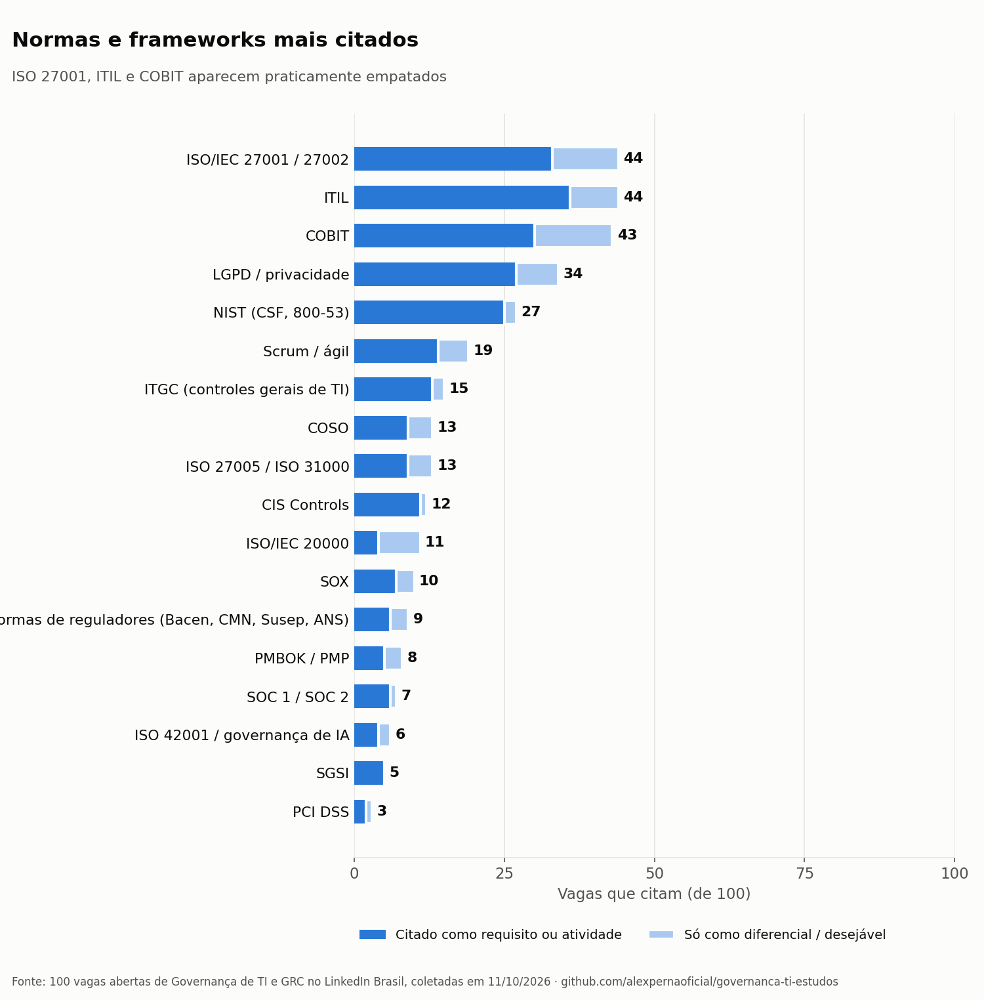
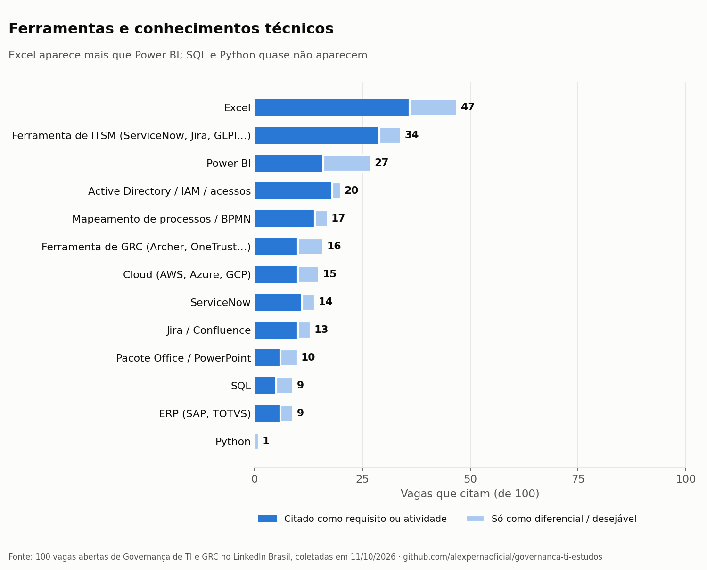
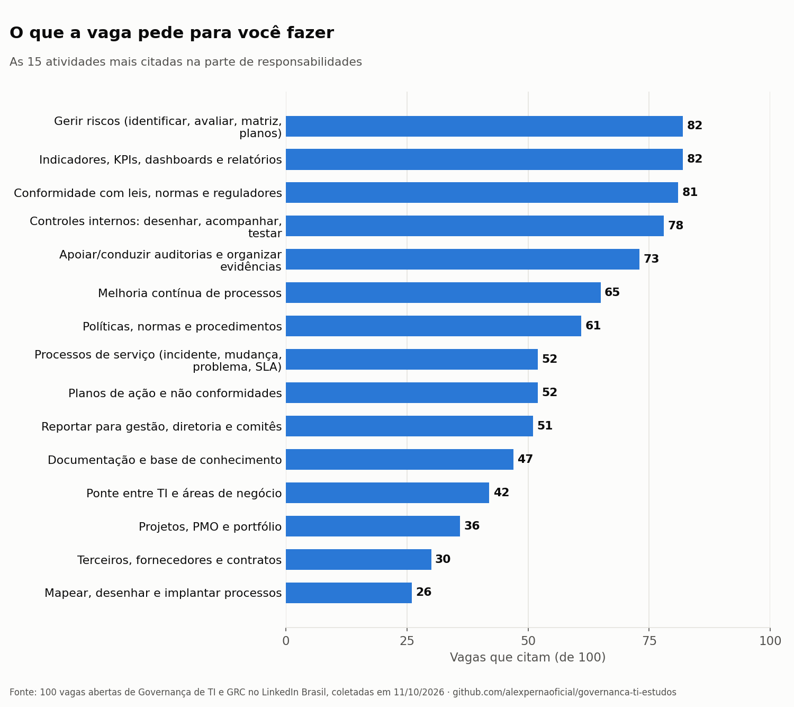
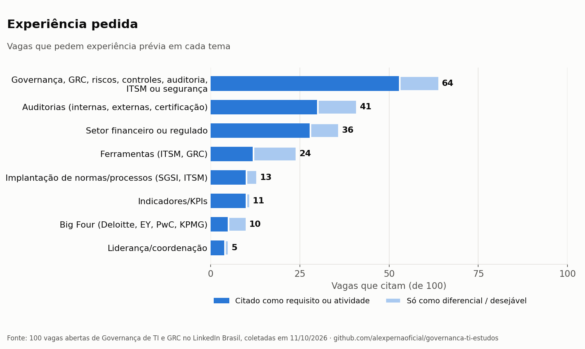
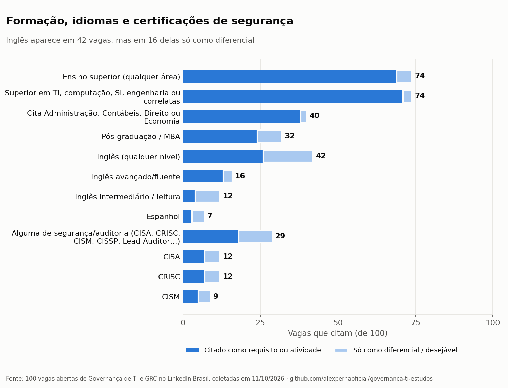
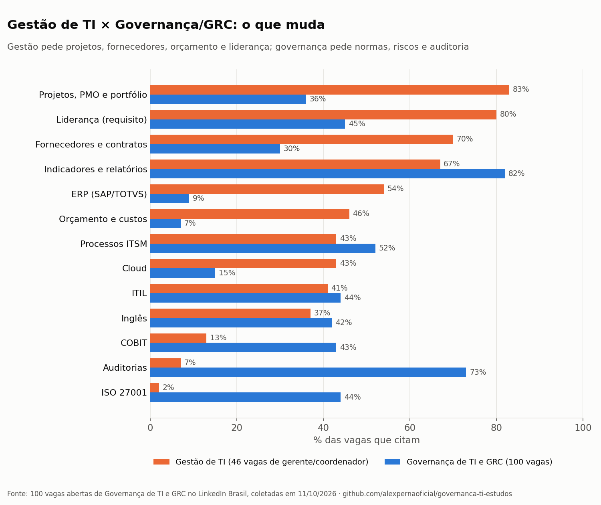

# O que as vagas de Governança de TI e GRC pedem

**Um retrato de 100 vagas abertas no Brasil (LinkedIn, outubro de 2026)**

Quem está entrando em Governança de TI ou GRC (Governança, Riscos e Compliance) costuma ter as mesmas dúvidas: "ITIL ou COBIT primeiro?", "preciso de ISO 27001?", "precisa de inglês?", "que diploma pedem?". Em vez de opinião, fui contar. Li a descrição completa de 100 vagas abertas e organizei o que elas pedem em comum: requisitos, ferramentas, responsabilidades e experiência.

> 📊 **Versão interativa:** [página com os gráficos e a lista de vagas](https://claude.ai/artifact/VwJ2Q7bKyQB6m29jhTd5D4)
> 📁 **Dados abertos:** pasta [`dados/`](dados/) (CSV). Use à vontade, citando a fonte.

---

## Resumo em 7 pontos

1. **ISO 27001, ITIL e COBIT são o trio central e aparecem praticamente empatados**: 44, 44 e 43 vagas de 100. Nenhuma certificação aparece na maioria das vagas.
2. **O que aparece em quase todas é o trabalho**: gerir riscos (82), indicadores e relatórios (82), conformidade (81), controles internos (78) e auditorias (73).
3. **Auditoria é o grande divisor**: 73 vagas falam de auditoria nas atividades e 41 pedem experiência com auditoria.
4. **Diploma**: 74 vagas citam ensino superior, quase sempre "em TI ou áreas correlatas". Pós ou MBA aparece em 32.
5. **Ferramentas**: Excel (47) aparece mais que Power BI (27). Ferramenta de chamados/ITSM aparece em 34. SQL aparece em 9 e Python em 1.
6. **Inglês aparece em 42 vagas**, mas em 16 delas só como diferencial. O avançado/fluente aparece em 16.
7. **O mercado está pedindo gente experiente**: 52 das 100 vagas são sênior, especialista ou gestão; só 9 são júnior. Quando a vaga diz quantos anos, o pedido vai de 2 a 8 (mediana 4).

---

## Quem são as 100 vagas

| Tipo de vaga | Vagas |
|---|---|
| Governança de TI | 36 |
| GRC / Segurança da informação | 29 |
| Riscos, controles internos e auditoria de TI | 25 |
| Governança de serviços (ITSM) | 8 |
| Governança de IA / dados | 2 |

| Nível (pelo título) | Vagas | | Local | Vagas | | Modelo | Vagas |
|---|---|---|---|---|---|---|---|
| Sênior, especialista ou gestão | 52 | | São Paulo | 62 | | Híbrido | 30 |
| Pleno | 19 | | Minas Gerais | 8 | | Remoto | 10 |
| Júnior / assistente | 9 | | Paraná | 6 | | Presencial | 8 |
| Não informado | 20 | | Rio de Janeiro | 5 | | Não informado | 52 |
| | | | Remoto / Brasil | 9 | | | |
| | | | Outros estados | 10 | | | |

A lista completa, com empresa, local, data e link de cada vaga, está em [`dados/vagas.csv`](dados/vagas.csv).

---

## 1. Normas e frameworks

- O trio **ISO 27001 + ITIL + COBIT** lidera, seguido de **LGPD** (34) e **NIST** (27).
- Nas vagas de **auditoria e controles**, aparecem **ITGC** (controles gerais de TI: acessos, mudanças e operação), **COSO** e **SOX**.
- **ISO/IEC 20000** aparece em 11 vagas, mas em 7 delas só como diferencial.
- Governança de IA (**ISO 42001**) ainda é rara: 6 vagas.

## 2. Ferramentas e conhecimentos técnicos

- **Excel** é a ferramenta mais citada (47), à frente de **Power BI** (27).
- **Ferramenta de chamados (ITSM)** aparece em 34; **ServiceNow** é a mais citada pelo nome (14).
- **Ferramentas de GRC** (Archer, OneTrust e similares) aparecem em 16.
- **Programação quase não aparece**: SQL em 9 e Python em 1.

## 3. O que a vaga pede para você fazer

Juntando as atividades mais citadas, a vaga "média" de governança/GRC diz algo assim:

> *"Você vai identificar e acompanhar riscos de TI, manter controles internos funcionando, garantir conformidade com normas (ISO 27001, LGPD, reguladores), apoiar auditorias organizando evidências, cuidar de planos de ação, manter políticas e procedimentos atualizados, acompanhar indicadores e apresentar relatórios para a gestão, sempre buscando melhoria contínua."*

Ver as 24 atividades contadas

| Atividade | Vagas |
|---|---|
| Gerir riscos (identificar, avaliar, matriz, planos) | 82 |
| Indicadores, KPIs, dashboards e relatórios | 82 |
| Conformidade com leis, normas e reguladores | 81 |
| Controles internos: desenhar, acompanhar, testar | 78 |
| Apoiar/conduzir auditorias e organizar evidências | 73 |
| Melhoria contínua de processos | 65 |
| Políticas, normas e procedimentos | 61 |
| Processos de serviço (incidente, mudança, problema, SLA) | 52 |
| Planos de ação e não conformidades | 52 |
| Reportar para gestão, diretoria e comitês | 51 |
| Documentação e base de conhecimento | 47 |
| Ponte entre TI e áreas de negócio | 42 |
| Projetos, PMO e portfólio | 36 |
| Terceiros, fornecedores e contratos | 30 |
| Mapear, desenhar e implantar processos | 26 |
| Planejamento estratégico de TI | 23 |
| Continuidade de negócios (PCN, BIA, DRP) | 21 |
| Automação (Power Automate, scripts, IA) | 20 |
| Questionários de clientes / assessments | 19 |
| Conscientização e treinamentos | 19 |
| Gestão e revisão de acessos | 18 |
| Privacidade / LGPD | 17 |
| Orçamento e custos de TI | 7 |
| Governança de IA ou de dados | 3 |

## 4. Experiência pedida

- **64** pedem experiência prévia em governança, GRC, riscos, controles, auditoria, ITSM ou segurança.
- **41** pedem experiência com **auditorias** (internas, externas ou de certificação).
- **36** preferem quem já trabalhou em **setor financeiro ou regulado**.
- **10** citam passagem por **Big Four** (Deloitte, EY, PwC, KPMG), metade só como diferencial.
- Os termos mais comuns são "vivência" e "experiência sólida", geralmente sem número de anos. Nas 14 vagas que dizem o número, ele vai de 2 a 8 anos (mediana 4). As vagas júnior falam em cerca de 1 ano em TI, service desk ou ITSM.

## 5. Formação, idiomas e certificações de segurança

- Certificações avançadas de segurança e auditoria (**CISA, CRISC, CISM, CISSP**) aparecem em 29 vagas, quase sempre sênior. Várias delas exigem anos de experiência comprovada para emitir o certificado.
- "Cita Administração, Contábeis, Direito ou Economia" é uma contagem aproximada: nem toda menção é uma formação aceita.

## 6. Gestão de TI × Governança/GRC

Para comparar, também analisei **46 vagas de gerente, coordenador ou supervisor de TI**.

- **Gestão de TI** pede mais **projetos, fornecedores, orçamento, ERP e liderança de equipe**. ITIL é o framework mais citado nessas vagas.
- **Governança/GRC** pede mais **normas, riscos, controles e auditoria**.
- **ITIL e indicadores** aparecem forte nos dois caminhos.

---

## O que dá para tirar disso (para quem está começando)

Leitura minha dos números, não regra:

- **Comece pelo trio**, na ordem que fizer sentido para o seu trabalho atual. Quem vem do suporte costuma ter mais facilidade começando por ITIL.
- **Excel antes de Power BI.** Os dois aparecem, mas Excel aparece quase o dobro.
- **Procure contato com auditoria**, mesmo que pequeno: acompanhar uma auditoria interna, organizar evidências, revisar acessos. É o item que mais separa quem tem experiência de quem não tem.
- **Experiência conta mais que certificado.** Indicadores, procedimentos, planos de ação e relatórios para a gestão já são trabalho de governança. Documente com números de antes e depois.
- **Porta de entrada provável**: vagas de **governança de serviços (ITSM)** e de **governança de TI júnior/pleno**, que pedem ITIL, ferramenta de chamados e experiência em suporte.

---

## Como a pesquisa foi feita

1. **Coleta (11/10/2026):** busca pública de vagas do LinkedIn, localização "Brasil", com 17 termos: governança de TI, analista de governança de TI, GRC, analista de GRC, governança riscos e compliance, compliance de TI, riscos de TI, gestão de TI, coordenador de TI, gerente de TI, analista de processos de TI, ITSM, gestão de serviços de TI, governança segurança da informação, IT governance, auditoria de TI e controles internos TI. Foram 371 vagas diferentes.
2. **Seleção:** filtrei pelo título as vagas de governança de TI, GRC, ITSM e riscos/controles/auditoria de TI. Tirei as de governança corporativa sem foco em TI e fiquei com as **100 mais recentes** (a maioria publicada entre setembro e outubro de 2026). As 46 vagas de gerente/coordenador de TI ficaram numa comparação à parte.
3. **Leitura:** baixei a descrição completa de cada vaga.
4. **Contagem:** um script conta em quantas vagas aparece cada termo, usando uma lista de palavras e variações (por exemplo, "ISO 27001" ou "27002"; "Power BI" ou "PowerBI").
   - **"Só como diferencial"**: o termo aparece apenas depois de palavras como "diferencial" ou "desejável".
   - **Responsabilidades**: contadas só no trecho antes da seção de requisitos.

**Limites:**
- É contagem de palavras, não leitura humana de cada vaga. Os números servem para **comparar a importância** entre itens, não como porcentagem exata.
- As categorias de responsabilidade são amplas: uma vaga que cita "riscos" uma vez já conta.
- É uma foto de um momento (outubro de 2026), de uma única plataforma, com muitas vagas de São Paulo.
- Os links das vagas expiram quando a vaga fecha.

---

## Links oficiais para estudar

| Tema | Onde |
|---|---|
| ITIL (Version 5) | [PeopleCert](https://www.peoplecert.org) |
| COBIT | [ISACA · COBIT](https://www.isaca.org/resources/cobit) |
| CISA, CRISC, CISM | [ISACA · Credenciais](https://www.isaca.org/credentialing) |
| ISO/IEC 27001 | [ISO · 27001](https://www.iso.org/standard/27001) |
| NIST Cybersecurity Framework | [NIST CSF](https://www.nist.gov/cyberframework) |
| CIS Controls | [Center for Internet Security](https://www.cisecurity.org/controls) |
| LGPD (Lei 13.709/2018) | [Planalto](https://www.planalto.gov.br/ccivil_03/_ato2015-2018/2018/lei/l13709.htm) |
| Aulas gratuitas de governança | [TIexames · gratuitos](https://tiexames.com.br/gratuitos.php) |
| Minhas notas de estudo | [repositório de estudos](https://github.com/alexpernaoficial/governanca-ti-estudos) |

---

## Dados

| Arquivo | O que tem |
|---|---|
| [`dados/vagas.csv`](dados/vagas.csv) | As 100 vagas: título, empresa, local, data, grupo e link |
| [`dados/contagens.csv`](dados/contagens.csv) | Quantas vagas citam cada item, por categoria, e quantas só como diferencial |
| [`dados/perfil.csv`](dados/perfil.csv) | Tipo, nível, local e modelo de trabalho |
| [`dados/gestao-ti-vs-governanca.csv`](dados/gestao-ti-vs-governanca.csv) | Comparação com 46 vagas de gestão de TI (%) |

Se você usar os dados ou os gráficos, cite a fonte: *"Pesquisa de 100 vagas de Governança de TI e GRC, LinkedIn Brasil, out/2026 · github.com/alexpernaoficial/pesquisa-vagas-governanca-grc"*. Correções e sugestões são bem-vindas: abra uma *issue* aqui no repositório.

---
Alex Perna · estudante de Governança de TI · [LinkedIn](https://www.linkedin.com/in/alexpernaoficial)
